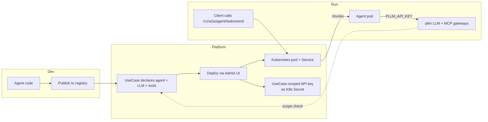

# Agents Overview

An **agent** in pllm is an autonomous service that uses LLMs and MCP tools to
do real work on behalf of a user. Teams author them in whatever stack they
like — LangGraph, custom Python, anything that can run in a container.

pllm handles everything around the agent: publishing, approval, deployment,
secret distribution, scope enforcement, and audit.

## The contract

An agent is a container that exposes one endpoint:

```
POST /invoke
Content-Type: application/json

{
  "input": <any>,
  "task_id": "<string>"
}

-> 200 OK
{
  "output": <any>,
  "error": "<optional string>"
}
```

That's the whole runtime contract. Anything behind `/invoke` is the team's
business. The reference `echo` agent at `deploy/agent-reference/echo/` is
about 15 lines of Flask.

## What pllm adds around it



**Key mechanisms:**

1. **Use case binding at deploy time.** When you deploy an agent and pick a
   use case, pllm mints a use-case-scoped API key and mounts it into the pod
   as `PLLM_API_KEY`.
2. **Scope at runtime.** The agent calls pllm's LLM and MCP gateways using
   its own key. Those calls are scoped automatically — the agent code doesn't
   need to know about use cases at all.
3. **Secret distribution.** Any `env` values in the deploy payload are stored
   as Kubernetes Secrets and projected into the pod; the secret's lifecycle
   matches the deployment.

## The two registry entries an agent has

Every agent touches **two** things in the registry:

### `RegistryAgent` — the spec

```json
{
  "kind": "agent",
  "name": "pllm.io/agent-research",
  "version": "0.1.0",
  "package": {
    "type": "oci",
    "identifier": "ghcr.io/example/agent-research:0.1.0"
  },
  "refs": [
    { "target_kind": "server", "target_name": "brave-search-mcp", "local_name": "search" },
    { "target_kind": "llm",    "target_name": "my-gpt-4",           "local_name": "default_model" }
  ]
}
```

The `refs` array is **the composition graph**. This agent's declared
dependencies — one MCP server and one LLM. The platform team reviews this
before approving any use case that includes the agent.

### `AgentDeployment` — the running instance

Stored in a separate table; one per actual Kubernetes workload. Includes:

- `registry_name + registry_version` (pointing back to the spec)
- `use_case_id` (what governs it)
- `key_id` (the minted scoped key)
- `status`, `replicas`, `resource requests`

Undeploying deletes the `AgentDeployment` and the K8s objects. The
`RegistryAgent` spec remains — it can be deployed again under a different use
case later.

## Exposing agents to clients

### Via A2A (JSON-RPC)

```bash
curl -X POST http://localhost:8080/v1/a2a/agent-research/tasks/send \
  -H "Authorization: Bearer $KEY" \
  -d '{
    "jsonrpc": "2.0",
    "method": "tasks/send",
    "params": { "input": { "query": "..." } },
    "id": 1
  }'
```

A2A is an emerging standard for agent-to-agent communication — JSON-RPC over
HTTP. pllm proxies to the pod's `/invoke` endpoint, wrapping the result in
the A2A envelope.

Agents also expose a machine-readable card at:

```
GET /v1/a2a/{slug}/.well-known/agent.json
```

Useful for programmatic discovery.

### Via admin API (direct invoke)

```bash
curl -X POST http://localhost:8080/api/admin/agents/{id}/invoke \
  -d '{"input": {"query": "..."}, "task_id": "demo-1"}'
```

Same pod endpoint, no A2A envelope. Used by the UI's **Invoke** button.

## What's next

- [Authoring & Publishing](/agents/authoring) — writing a new agent and
  publishing it to the registry
- [Onboarding Walkthrough](/agents/onboarding) — end-to-end demo: publish →
  approve → deploy → invoke → audit
- [A2A Interoperability](/agents/a2a) — JSON-RPC contract and the agent card
