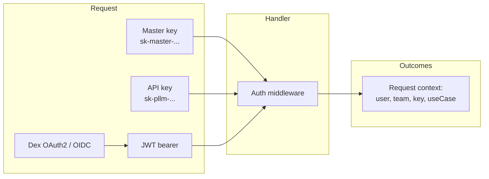
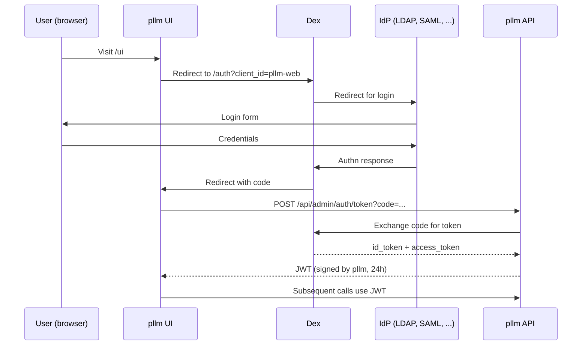

# Authentication

pllm supports three authentication flows. They're not mutually exclusive —
all can be active at once and the gateway picks the right one per request.

## The three flows



## 1. Master key

Set in config:

```yaml
auth:
  master_key: sk-master-dev-key-change-in-production
```

Or via environment: `PLLM_MASTER_KEY=...`

Used for bootstrap admin operations and emergency access. **Always bypasses
ACLs, scope checks, and budgets.** Rotate if compromised.

```bash
curl -H "Authorization: Bearer sk-master-..." \
  http://localhost:8080/api/admin/keys
```

## 2. API keys

Long-lived credentials minted via the admin API or UI. Most traffic uses
these. See [API Keys & Permissions](/security/keys) for the full lifecycle.

```bash
curl -H "Authorization: Bearer sk-pllm-abc123..." \
  http://localhost:8080/v1/chat/completions \
  -d '{"model":"my-gpt-4", ...}'

# or equivalently
curl -H "X-API-Key: sk-pllm-abc123..." ...
```

## 3. OIDC via Dex

For human logins to the admin UI. pllm integrates with **any identity
provider supported by Dex**:

- LDAP / Active Directory
- SAML 2.0 providers
- GitHub / GitLab
- Google Workspace
- Microsoft Azure AD / Entra ID
- Keycloak
- Auth0
- Generic OpenID Connect / OAuth2

Configuration:

```yaml
auth:
  require_auth: true
  dex:
    enabled: true
    issuer: "http://dex:5556/dex"                    # backend URL
    public_issuer: "http://localhost:5556/dex"       # frontend URL
    client_id: "pllm-web"
    client_secret: "pllm-web-secret"
    redirect_url: "http://localhost:3000/auth/callback"
    scopes: ["openid", "profile", "email", "groups"]

    group_mappings:
      "admin": "administrators"
      "engineering": "default-team"
```

OIDC users are created on first login (lazy provisioning) and placed in the
team their IdP group maps to.

### The flow



The JWT pllm issues **is not the Dex token** — pllm mints its own JWT signed
by `jwt.secret_key` and includes the user / team / role claims. This way
downstream pllm services only need to trust pllm's signing key, not Dex.

### Dex endpoints on pllm

```
POST /api/admin/auth/token             Exchange Dex code for pllm JWT
GET  /api/admin/auth/userinfo          Dex userinfo passthrough
GET  /api/auth/config                  Public config — what auth flows are enabled
```

The UI calls `/api/auth/config` on first load to decide which login button to
show (password, SSO, or both).

## JWT settings

```yaml
jwt:
  secret_key: your-super-secret-jwt-key-change-this
  expiry: 24h              # access token lifetime
  refresh_expiry: 168h     # refresh token lifetime (7 days)
```

Tokens are HS256 by default. You can swap to RS256 by providing a private /
public keypair — see `internal/core/auth/service.go`.

## Registration and password-based auth

pllm ships a built-in register / login flow for dev environments. Disable
when Dex is your IdP:

```yaml
auth:
  allow_password_auth: false    # force OIDC
```

Endpoints (when enabled):

```
POST /v1/register          First-time user registration
POST /v1/login             Password login → JWT
POST /v1/refresh           Refresh JWT using refresh token
```

## Team-scoped access

Users belong to teams. Teams have:

- Budget limits (shared across all team keys)
- Model allowlists (applied if a team key's own allowlist is empty)
- Role-based admin within the team
- Registry permissions (inherited by team-owned keys)

## Admin bootstrap

On first startup with an empty database, pllm creates an initial admin user:

```yaml
admin:
  username: admin
  password: changeme123!
  email: admin@pllm.io
```

**Change the default password immediately**. The admin user has `*:*`
registry permissions and can issue keys. The master key exists independently
for operations that must not depend on the database.

## Auth for service-to-service

Internal pllm processes (the MCPBridge, deployment watcher, agent A2A
handler) authenticate with **system-type keys** minted at startup. These are
stored in the database and rotated on pllm restart. They never leave the
cluster and aren't exposed through any API.

## Production checklist

- [ ] Change `jwt.secret_key` to a strong random value
- [ ] Change or remove the default admin password
- [ ] Set `auth.require_auth: true`
- [ ] Configure Dex with your IdP
- [ ] Set `cors.allowed_origins` to your actual origins
- [ ] Use PostgreSQL with SSL (`?sslmode=require` in the URL)
- [ ] Put the master key in a secret manager, not in `config.yaml`
- [ ] Set `ExpiresAt` on API keys; rotate on a schedule
- [ ] Enable audit logging; ship logs off-host
