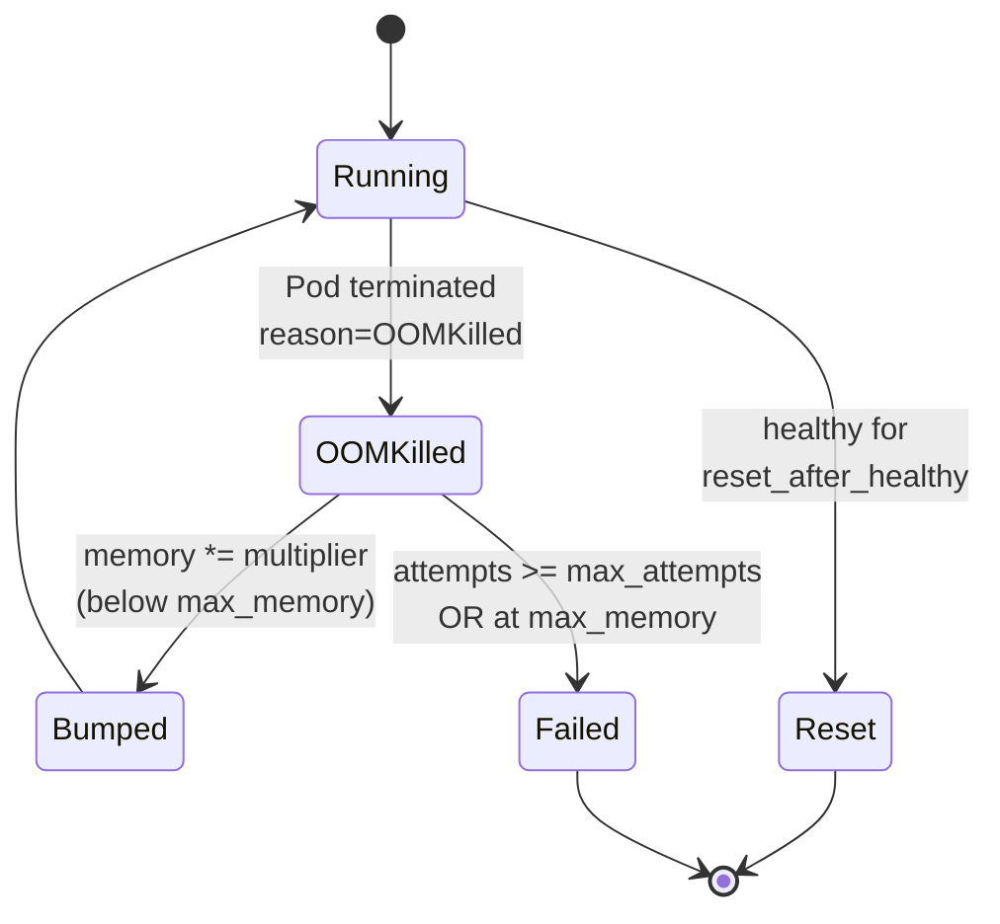

# OOM Autoscaling

When a deployment gets OOMKilled, pllm can bump its memory limit and redeploy
automatically — up to a configurable cap. This is a small but practical feature
for MCP servers whose working-set size is unknown until they're actually used.

## The loop



Steps:

1. pllm watches pod events in the deployment namespace
2. On `OOMKilled`, increments the deployment's `oom_attempts` counter
3. If `oom_attempts <= max_attempts` and current memory `< max_memory`:
   - Multiply the memory limit by `multiplier`
   - Patch the Deployment (triggers rolling restart)
   - Record a `DeploymentEvent{kind: oom_bumped, detail: "256Mi → 512Mi"}`
4. If the pod runs healthy for `reset_after_healthy`, reset the counter

## Configuration

```yaml
deployment:
  oom_autoscale:
    enabled: true
    multiplier: 2.0              # 256Mi → 512Mi → 1Gi → ...
    max_attempts: 3              # Give up after 3 bumps
    max_memory: "4Gi"            # Hard ceiling regardless of attempts
    reset_after_healthy: 30m     # Healthy window to reset counter
    poll_interval: 30s           # How often to reconcile
```

All fields live in `config.yaml` — see `internal/core/config/config.go:83`.

## Per-deployment override

You can disable autoscale for a specific deployment without turning the whole
feature off:

```bash
curl -X PUT http://localhost:8080/api/admin/deployments/<id>/oom/autoscale \
  -H "Authorization: Bearer $MASTER" \
  -d '{"enabled": false}'
```

Useful when you know a deployment's true working-set size and don't want
surprise memory allocations on an accidental OOM.

## Manual operations

Sometimes the auto loop does the wrong thing. Three escape hatches:

### Manual bump

```bash
curl -X POST http://localhost:8080/api/admin/deployments/<id>/oom/bump \
  -H "Authorization: Bearer $MASTER"
```

Forces one bump regardless of cooldown. Useful when you know the next request
is about to arrive and you want to pre-scale.

### Reset counter

```bash
curl -X POST http://localhost:8080/api/admin/deployments/<id>/oom/reset \
  -H "Authorization: Bearer $MASTER"
```

Clears `oom_attempts`. Good for "I bumped it manually and know the current
size is right, don't fail-fast on the next OOM."

### Redeploy with explicit resources

Undeploy + redeploy with the resource block you want. Resets everything.

## Events

Every decision is audited:

```bash
curl "http://localhost:8080/api/admin/deployments/events?deployment_id=<id>&kind=oom_bumped"
```

Returns rows like:

```json
{
  "deployment_id": "...",
  "kind": "oom_bumped",
  "outcome": "success",
  "detail": "memory: 256Mi -> 512Mi, attempts: 1/3",
  "at": "2026-04-24T10:12:34Z"
}
```

`kind: oom_killed` (from the watcher) also lands here. If you want a webhook
on every OOM, subscribe to `deployment.status_changed` and filter client-side.

## When to disable autoscale

- You run strict quotas and want OOMs to surface as failures, not silent bumps
- You have a VPA (Vertical Pod Autoscaler) already managing sizes
- The subprocess leaks memory and bumping just buys minutes before the next OOM

In those cases, set `oom_autoscale.enabled: false` globally, or leave it on
globally and disable per-deployment.
