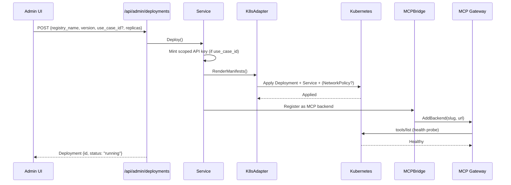

# Deployments Overview

pllm can deploy registry artifacts to Kubernetes with one click. It renders
manifests, applies them, watches for readiness, and — critically —
**auto-registers the resulting workload** as an MCP backend or agent endpoint.

## What gets deployed

| Artifact | Workload type | Auto-wiring |
|---|---|---|
| `RegistryServer` (stdio runtime) | Deployment + Service via wrapper image | Added as MCP backend via `MCPBridge` |
| `RegistryServer` (OCI runtime) | Deployment + Service directly | Added as MCP backend |
| `RegistryAgent` | Deployment + Service | Reachable via `/v1/a2a/<slug>` |

HTTP-only servers (`runtime: "http"`) don't deploy — pllm just stores the URL
and points the MCP gateway at it.

## Flow



## Endpoints

```
POST   /api/admin/deployments                List or create
GET    /api/admin/deployments/{id}           Read
DELETE /api/admin/deployments/{id}           Undeploy
POST   /api/admin/deployments/{id}/status    Force status refresh
GET    /api/admin/deployments/events         Operational event stream

POST   /api/admin/deployments/{id}/oom/bump       Manual memory bump
POST   /api/admin/deployments/{id}/oom/reset      Reset counters
PUT    /api/admin/deployments/{id}/oom/autoscale  Toggle per-deployment

POST   /api/admin/agents                     Deploy an agent artifact
GET    /api/admin/agents/{id}                Read
DELETE /api/admin/agents/{id}                Undeploy
```

## Deploy payload

```json
{
  "registry_kind": "server",
  "registry_name": "official/github-mcp",
  "registry_version": "2024.11.5",
  "use_case_id": "uuid-...",            // optional: binds a scoped key
  "replicas": 1,
  "resources": {
    "requests": { "cpu": "100m", "memory": "256Mi" },
    "limits":   { "cpu": "500m", "memory": "512Mi" }
  },
  "env": {
    "GITHUB_PERSONAL_ACCESS_TOKEN": "ghp_..."
  },
  "restrict_egress": true
}
```

`use_case_id` is the bridge between governance and runtime. When set:

1. pllm mints a **use-case-scoped API key**
2. The key is mounted into the pod as a Kubernetes Secret (`PLLM_API_KEY`)
3. Outbound calls from the pod to pllm's `/v1/*` endpoints are automatically
   scoped — the pod's code doesn't need to know anything about scope

## Status lifecycle

| Status | Meaning |
|---|---|
| `pending` | Accepted, rendering manifests |
| `deploying` | Applied to cluster, waiting for pods |
| `running` | Pods healthy, MCP/A2A endpoints answering |
| `unhealthy` | Pod running but failing probes |
| `failed` | Image pull error, crashloop, or OOM over max attempts |
| `undeployed` | Manifests deleted, row retained for history |

The Deployments UI auto-refreshes every 5 seconds and animates transitions.

## Where it runs

```yaml
deployment:
  enabled: true
  kubernetes:
    in_cluster: true                     # inside a pod with service account
    kubeconfig_path: ""                  # or a local kubeconfig for dev
    namespace: pllm-mcp                  # MCP server workloads
    agent_namespace: pllm-agents         # agent workloads (separate NS)
    wrapper_image: pllm/mcp-wrapper:dev  # stdio→HTTP shim
    restrict_egress: false               # NetworkPolicy DNS-only when true
```

See [K8s Adapter](/deployments/k8s) for the RBAC requirements and manifest
details.

## Why separate namespaces?

Agents and MCP servers have different risk profiles:

- **MCP servers** often have broad tool APIs (filesystem, GitHub, etc.) and
  are the thing a use case approves
- **Agents** are the orchestration layer — they call MCP servers, call LLMs,
  keep state

Splitting by namespace lets you apply different NetworkPolicies, PSP/OPA rules,
and resource quotas to each. Nothing in pllm hardcodes the split — you can
use the same namespace if you prefer.

## What's next

- [K8s Adapter](/deployments/k8s) — manifest details, RBAC, namespaces
- [Wrapper Image](/deployments/wrapper) — how stdio packages become HTTP
- [OOM Autoscaling](/deployments/oom) — automatic memory bumps on OOMKilled
- [Network Policy](/deployments/network-policy) — egress restriction
