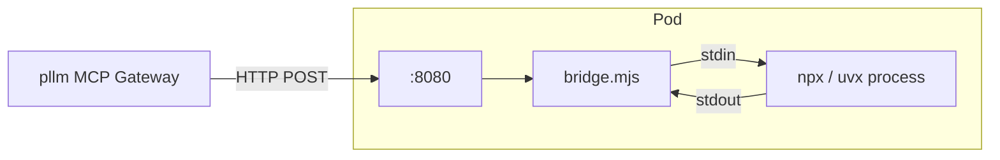

# Wrapper Image (npx/uvx → HTTP)

Most MCP servers on npm and PyPI are **stdio** — they read JSON-RPC from stdin
and write to stdout. That's fine for Claude Desktop launching a subprocess, but
it's not something you can put behind a Kubernetes Service. The wrapper image
solves that.

## What it does

The wrapper is a tiny Node.js program (`deploy/mcp-wrapper/bridge.mjs`) that:

1. Spawns the wrapped command as a subprocess (`npx -y <pkg>` or `uvx <pkg>`)
2. Opens an HTTP server on the container's port 8080
3. Accepts POST requests with MCP JSON-RPC envelopes
4. Proxies each request into the subprocess's stdin and the response back



The subprocess sees stdio — exactly what it expects. The gateway sees HTTP —
exactly what it can load-balance.

## Building it

```bash
# For local minikube (loads into minikube's docker daemon)
make wrapper-image-minikube

# For a regular registry push
docker build -t pllm/mcp-wrapper:dev deploy/mcp-wrapper/
docker push pllm/mcp-wrapper:dev
```

The image tag comes from `deployment.kubernetes.wrapper_image` in `config.yaml`
— make sure they match.

## Environment contract

The wrapper reads two env vars to figure out what to run:

| Var | Example | Purpose |
|---|---|---|
| `PLLM_WRAPPED_CMD` | `npx` | Executable |
| `PLLM_WRAPPED_ARGS` | `-y @modelcontextprotocol/server-github` | Args (space-separated) |

Any other env vars (API keys, tokens) are forwarded to the subprocess
unchanged. They come from the deploy payload's `env` field, stored as a K8s
Secret, and mounted into the container.

## Health

The wrapper exposes:

- `GET /health` — returns 200 once the subprocess is running
- `GET /ready` — returns 200 once a first `tools/list` has succeeded

The K8sAdapter points livenessProbe at `/health` and readinessProbe at
`/ready`. If the subprocess crashes, `/health` fails and K8s restarts the pod.

## Resource sizing

The wrapper is negligible (~30 MB). Sizing is entirely the subprocess's
concern. Defaults:

- CPU request: `100m`, limit: `500m`
- Memory request: `256Mi`, limit: `512Mi`

For heavier MCP servers (full-text indexing, embeddings, etc.), override on
deploy:

```json
{
  "resources": {
    "requests": { "cpu": "500m", "memory": "1Gi" },
    "limits":   { "cpu": "2",    "memory": "4Gi" }
  }
}
```

Or let [OOM Autoscaling](/deployments/oom) bump memory on OOMKilled automatically.

## When you don't need the wrapper

Servers packaged as a self-contained HTTP binary don't need the wrapper. Set:

```json
{
  "package": {
    "type": "oci",
    "identifier": "ghcr.io/example/my-mcp-http:1.0.0",
    "runtime": "oci"
  },
  "transport": "http"
}
```

pllm deploys the image directly and points the gateway at the Service.

## Security notes

The wrapper runs **as root inside the container** by default so it can
`npx install` at startup. For production:

- Use an internal npm mirror to avoid DNS-based supply-chain attacks
- Set `restrict_egress: true` on the deployment to generate a NetworkPolicy
  that allows only DNS egress (see [Network Policy](/deployments/network-policy))
- Consider pre-baked custom wrappers for high-traffic packages — bake the
  package into the image instead of `npx`-installing at each pod startup

## Debugging

If a stdio server mysteriously fails:

```bash
# Grab the pod logs — wrapper + subprocess stdout are both visible
kubectl -n pllm-mcp logs -l pllm.io/deployment-id=<uuid>

# Exec into the pod
kubectl -n pllm-mcp exec -it <pod> -- sh

# From inside the pod, try running the command manually
$PLLM_WRAPPED_CMD $PLLM_WRAPPED_ARGS
```

A subprocess that fails to start before the readiness probe times out is the
most common failure mode. Usually it's a missing env var, an unreachable
external API, or a node_modules cache miss.
