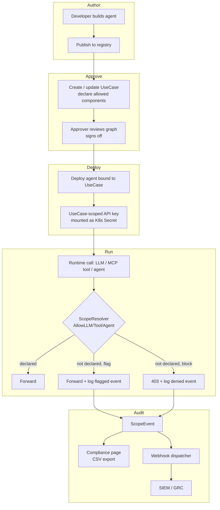

# Governance Overview (MRM)

> "Every team at this org now has an AI agent. The platform team can't audit
> each one, but they need an answer when the auditor calls."

pllm's governance layer — internally called the **MRM layer** after Model Risk
Management — gives you that answer. It's built around three ideas:

1. **Use Cases are the unit of approval.** Not agents, not models — use cases.
2. **Keys are bound to use cases.** A bound key inherits the use case's scope.
3. **Runtime enforces it.** Every LLM / MCP / agent call is checked against
   the use case's declared component set. Denials are persisted.

## The loop



## What's a UseCase?

A `UseCase` is a top-level entity with its own lifecycle, its own approval
record, and a declared set of components (agents, servers, skills, prompts,
LLMs) that are permitted for this business activity.

```json
{
  "id": "uuid-...",
  "name": "customer-research-approved",
  "description": "Research agent used by Customer Success...",
  "status": "approved",
  "risk_tier": "high",
  "data_classifications": ["PII", "confidential"],
  "effective_classifications": ["PII", "confidential", "public"],
  "enforce_scope": true,
  "approval_record": {
    "approver": "risk-team@example.com",
    "approved_at": "...",
    "ticket": "GRC-2345"
  },
  "compliance_flag": null
}
```

## What's scope enforcement?

At call time, the platform knows three things:

1. **Which key is making this call?** (from the bearer)
2. **What use case is the key bound to?** (from `Key.UseCaseID`)
3. **Is this resource declared under that use case?** (`RegistryRef` lookup)

If the answer to (3) is "no":

- `EnforceScope: false` — flag mode. Request proceeds; `ScopeEvent{outcome: flagged}` is logged.
- `EnforceScope: true` — block mode. Request fails with 403 / JSON-RPC error; `ScopeEvent{outcome: denied}` is logged.

Unbound keys (`UseCaseID` is null) bypass entirely. Master key always bypasses.

## What's a ScopeEvent?

Every allow/deny decision (the denials, and flagged events in flag mode)
produces a persisted row:

```json
{
  "id": "uuid-...",
  "use_case_id": "uuid-...",
  "key_id": "uuid-...",
  "kind": "mcp_tool | llm | agent",
  "target_kind": "server | llm | agent",
  "target_name": "official/github-mcp",
  "tool_name": "search_repos",      // only for kind=mcp_tool
  "outcome": "denied | flagged",
  "reason": "server not declared under use case",
  "at": "..."
}
```

This is the audit trail — queryable, CSV-exportable, and fired via webhook.

## What about approvals?

pllm doesn't implement an approval workflow itself. The `ApprovalRecord` field
on `UseCase` is an opaque JSON blob — stick whatever your GRC tool returns
(ticket ID, approver, timestamps, signatures). The point is: once a use case
is marked `approved`, its dependency graph is what the platform enforces.

To integrate with ServiceNow, GRC Cloud, or Archer: subscribe to
`use_case.created` and `use_case.updated` webhooks and push to the ticket.

## The EE gate

The entire MRM layer — `use_cases/`, `webhooks/`, the Compliance page — is
structured as an optional feature:

- No other Go package imports `use_cases` directly; all integration goes
  through interfaces (`ScopeChecker`, `ScopeEventRecorder`, `WebhookEmitter`)
- Removing the init block in `api/router/router.go` disables everything
  cleanly
- Sidebar entries can be fenced behind a capability flag from
  `/api/auth/config`

In the open-source build the MRM layer is always on if Postgres is available.
In a future Enterprise Edition the toggle lives in `api/router/admin.go` where
`cfg.UseCaseHandler != nil` already gates the routes.

## What's next

- [Use Cases](/governance/use-cases) — CRUD, data classifications, reconciler
- [Scope Enforcement](/governance/scope) — the exact allow/deny semantics
- [Audit](/governance/audit) — querying ScopeEvents, CSV export
- [Webhooks](/governance/webhooks) — HMAC-signed delivery to external systems
