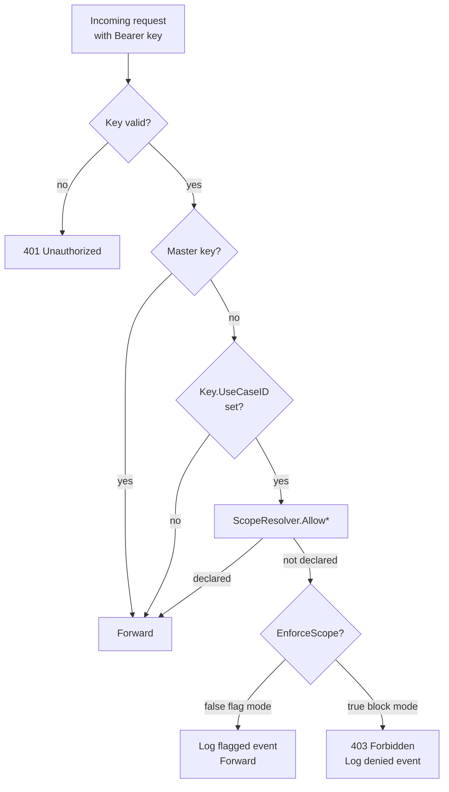

# Scope Enforcement

Scope enforcement is pllm's runtime authorization layer. Every LLM call, MCP
tool invocation, and agent dispatch is checked against the calling key's
bound use case before it's forwarded upstream.

## The decision tree



Only keys with `UseCaseID` set are scoped. Keys without a use case bypass —
this is backward compatibility for pllm's original LLM-only role.

## The three checks

### `AllowLLM(useCaseID, modelName)`

Called inside the chat handler before dispatching to a provider. Looks up the
use case's refs where `target_kind="llm"` and `target_name=modelName`.

```go
// Chat handler
ok, reason := scopeChecker.AllowLLM(ctx, useCaseID, req.Model)
if !ok && useCase.EnforceScope {
    events.Record(useCaseID, "llm", req.Model, "denied", reason)
    return 403
}
if !ok {
    events.Record(useCaseID, "llm", req.Model, "flagged", reason)
}
// proceed
```

### `AllowMCPTool(useCaseID, serverSlug, toolName)`

Called in the MCP gateway before forwarding to a backend. Checks for a ref
with `target_kind="server"` that matches the server's slug.

Slug matching is forgiving — accepts:

- The full registry name (`official/github-mcp`)
- Just the last path segment (`github-mcp`)
- The `LocalName` alias declared on the ref (`github`)

This way operators can bind use cases using whichever style their team
prefers without breaking runtime.

### `AllowAgent(useCaseID, agentName)`

Called when a key used by an agent invokes another agent (A2A). Checks for
`target_kind="agent"`.

## Performance: the cache

Scope checks are on the hot path. The `ScopeResolver` caches the
`(use_case_id → allowed sets)` mapping in-memory for **30 seconds**:

```go
type allowedSets struct {
    LLMs      map[string]bool
    Servers   map[string]bool      // keys = [full, last-segment, local-name]
    Agents    map[string]bool
    Skills    map[string]bool
    Prompts   map[string]bool
}
```

Cost of a cache hit: one map lookup. Cost of a miss: one indexed Postgres
query over `registry_refs`.

**Cache invalidation:** on every UseCase Create / Update / Delete, the resolver
clears the affected use case's entry. So changes propagate in the time it
takes Postgres to commit — not 30 seconds.

## Flag mode vs block mode

| Mode | `EnforceScope` | Call result | Audit event |
|---|---|---|---|
| Flag | `false` | Forwards upstream; may succeed or fail as normal | `outcome: flagged` |
| Block | `true` | Refused with 403 (or JSON-RPC error for MCP) | `outcome: denied` |

Flag mode is the **staged rollout** answer. You can turn a new use case on
without immediately breaking running agents, watch the flagged events, and
flip `EnforceScope=true` once you've verified nothing is surprising.

```bash
# Deploy in flag mode
PUT /api/admin/use-cases/{id} { "enforce_scope": false }

# Monitor flagged events for a week
GET /api/admin/use-cases/events?use_case_id={id}&outcome=flagged

# When clean, flip to block
PUT /api/admin/use-cases/{id} { "enforce_scope": true }
```

## The "bypass" semantics

Three bypass conditions, all intentional:

1. **Master key.** The master key is your last-resort admin credential —
   everything goes through it. Use sparingly; rotate if compromised.
2. **Key without use case.** A key with `UseCaseID=null` is explicitly
   unscoped. This is how pllm stays usable for simple LLM gateway deployments
   that don't need governance.
3. **Unmatched endpoints.** The chat handler (`/v1/chat/completions`) calls
   `AllowLLM`. Other LLM endpoints — `/v1/completions`, `/v1/embeddings`,
   `/v1/messages` — share handler infrastructure but **not the scope check**
   (as of writing). Extend when you need scoping on those; see
   [Gotchas](/#known-gaps-next-steps).

## Error shapes

### Chat / LLM denial

```json
{
  "error": {
    "message": "Model 'test-model-restricted' is not permitted under use case 'customer-research-approved'",
    "type": "permission_error",
    "code": "scope_denied"
  }
}
```
HTTP 403.

### MCP tool denial

JSON-RPC error:

```json
{
  "jsonrpc": "2.0",
  "id": 42,
  "error": {
    "code": -32604,
    "message": "Tool call denied by use case scope",
    "data": {
      "use_case_id": "...",
      "server": "official/github-mcp",
      "tool": "delete_repository"
    }
  }
}
```

### Agent denial

Standard HTTP 403 with JSON body. If the call is inter-agent via A2A, the
caller sees a JSON-RPC error as above.

## Testing scope

The smoke test script validates scope end-to-end:

```bash
bash scripts/test-mcp-registry.sh
```

For manual testing:

```bash
# Bind a key to a use case that only permits 'my-gpt-4'
KEY=$(curl -s -X POST ... | jq -r .key)

# Allowed model — succeeds
curl -H "Authorization: Bearer $KEY" \
  -d '{"model":"my-gpt-4","messages":[...]}' \
  http://localhost:8080/v1/chat/completions
# 200

# Blocked model — denied
curl -H "Authorization: Bearer $KEY" \
  -d '{"model":"test-model-restricted","messages":[...]}' \
  http://localhost:8080/v1/chat/completions
# 403

# Verify event was logged
curl -H "Authorization: Bearer $MASTER" \
  http://localhost:8080/api/admin/use-cases/events?outcome=denied
```
