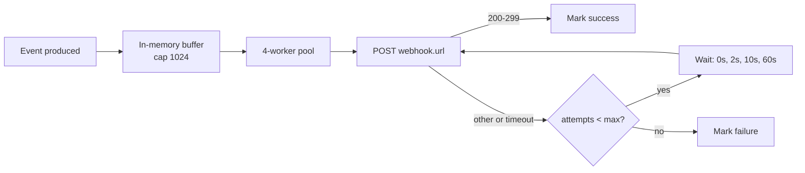

# Webhooks (SIEM / GRC integration)

pllm pushes events to external systems via HMAC-signed webhooks. This is how
you wire scope denials into Splunk / Datadog / ServiceNow / Slack / whatever
your risk team already uses.

## Event types

| Event | Fires when |
|---|---|
| `scope.denied` | Scope enforcement blocked a call |
| `scope.flagged` | Scope check would have blocked, but use case is in flag mode |
| `use_case.created` | POST to `/api/admin/use-cases` |
| `use_case.updated` | PUT to `/api/admin/use-cases/{id}` |
| `use_case.deleted` | DELETE |
| `use_case.compliance_flag` | Reconciler set a compliance flag |
| `registry.server.saved` | Server published or updated |

These names are a **stable contract** — once emitted, the name and payload
shape don't change in non-major releases.

## Subscribing

```bash
curl -X POST http://localhost:8080/api/admin/webhooks \
  -H "Authorization: Bearer $MASTER" \
  -H "Content-Type: application/json" \
  -d '{
    "name": "splunk-scope-denials",
    "url": "https://siem.example.com/webhook",
    "events": ["scope.denied", "scope.flagged"],
    "secret": "auto",
    "enabled": true
  }'
```

Returns:

```json
{
  "id": "uuid-...",
  "name": "splunk-scope-denials",
  "url": "https://siem.example.com/webhook",
  "events": ["scope.denied", "scope.flagged"],
  "secret": "whsec_abc123...",
  "enabled": true,
  "last_success_at": null,
  "last_failure_at": null,
  "last_error": null,
  "created_at": "..."
}
```

Save the `secret` — it's used to verify signatures on incoming deliveries.

`"secret": "auto"` asks pllm to mint a fresh secret. You can also pass your
own arbitrary string.

## Delivery



Delivery semantics:

- **In-process dispatcher**. 4 workers consume a buffered channel (cap 1024)
- **Retries**: `0s, 2s, 10s, 60s` backoff (4 attempts total)
- **Per-attempt timeout**: 10 seconds
- **Best-effort**. On pllm restart, in-flight events in the channel are lost.
  For durable delivery, a persistent queue table is on the roadmap.

Use the **`X-PLLM-Delivery-ID`** header to deduplicate on the receiver side.
Receivers should be idempotent.

## Request headers

```
POST /your-endpoint HTTP/1.1
Content-Type: application/json
User-Agent: pllm-webhooks/1.0
X-PLLM-Event: scope.denied
X-PLLM-Delivery-ID: 6f8c...d21a
X-PLLM-Attempt: 1
X-PLLM-Signature: sha256=ab12...ef34
```

`X-PLLM-Signature` is HMAC-SHA256 of the raw request body using the
webhook's secret.

## Payload shape

Every event has this envelope:

```json
{
  "event": "scope.denied",
  "delivery_id": "...",
  "delivered_at": "2026-04-24T10:12:34.123Z",
  "data": {
    ...event-specific...
  }
}
```

### `scope.denied` / `scope.flagged`

```json
{
  "data": {
    "scope_event": {
      "id": "...",
      "use_case_id": "...",
      "key_id": "...",
      "kind": "llm",
      "target_kind": "llm",
      "target_name": "test-model-restricted",
      "outcome": "denied",
      "reason": "model not declared under use case",
      "at": "2026-04-24T10:12:34Z"
    },
    "use_case": {
      "id": "...",
      "name": "customer-research-approved",
      "risk_tier": "high"
    }
  }
}
```

### `use_case.created` / `updated` / `deleted`

```json
{
  "data": {
    "use_case": { ...full UseCase row... },
    "diff": { ...fields that changed (updated only)... }
  }
}
```

### `registry.server.saved`

```json
{
  "data": {
    "server": {
      "name": "official/github-mcp",
      "version": "2024.11.5",
      "is_latest": true,
      "enrichment_score": 82
    }
  }
}
```

## Verifying signatures

### Node.js

```javascript
import crypto from "node:crypto";

function verifySignature(body, header, secret) {
  const signature = header.split("sha256=")[1];
  const expected = crypto
    .createHmac("sha256", secret)
    .update(body)
    .digest("hex");
  return crypto.timingSafeEqual(
    Buffer.from(signature, "hex"),
    Buffer.from(expected, "hex"),
  );
}
```

### Python

```python
import hmac, hashlib

def verify_signature(body: bytes, header: str, secret: str) -> bool:
    provided = header.removeprefix("sha256=")
    expected = hmac.new(
        secret.encode(),
        body,
        hashlib.sha256,
    ).hexdigest()
    return hmac.compare_digest(provided, expected)
```

### Go

```go
func verifySignature(body []byte, header, secret string) bool {
    sig := strings.TrimPrefix(header, "sha256=")
    mac := hmac.New(sha256.New, []byte(secret))
    mac.Write(body)
    expected := hex.EncodeToString(mac.Sum(nil))
    return hmac.Equal([]byte(sig), []byte(expected))
}
```

## Testing

Fire a test delivery without waiting for a real event:

```bash
curl -X POST http://localhost:8080/api/admin/webhooks/{id}/test \
  -H "Authorization: Bearer $MASTER"
```

Sends a canned `webhook.test` payload. The receiver sees normal headers
including `X-PLLM-Signature`.

## Disabling

Flip `enabled: false` — deliveries stop, but the subscription row is
retained. Useful when bisecting noisy webhooks.

```bash
curl -X PUT http://localhost:8080/api/admin/webhooks/{id} \
  -d '{"enabled": false}'
```

To re-enable, flip it back to `true`.

## Delivery log (roadmap)

Today, only the last attempt's status/error is persisted on the `Webhook`
row. A dedicated `WebhookDelivery` table with per-attempt history is on the
roadmap. Until then, audit delivery by subscribing a staging endpoint
(requestbin, webhook.site) and diffing against production receipts.
