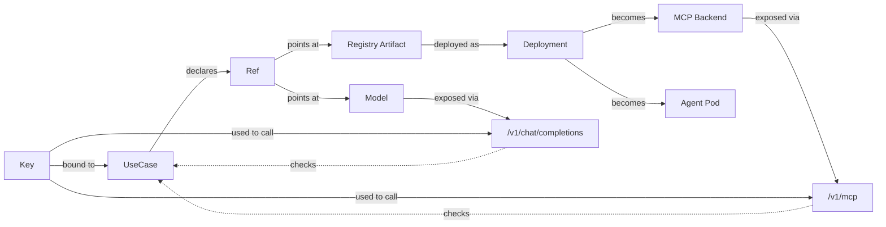

# Concepts

pllm has a small vocabulary. Understand these seven words and the rest of the
product falls into place.

## The seven nouns

| Noun | What it is | Where it lives |
|---|---|---|
| **Model** | A named, configured LLM instance (e.g., `my-gpt-4` → OpenAI GPT-4) | `model_list` in config + `UserModel` table |
| **MCP Backend** | A running MCP server that exposes tools | `MCPServer` table |
| **Registry Artifact** | A versioned catalog entry (Server / Agent / Skill / Prompt) | `RegistryServer`, `RegistryAgent`, `RegistrySkill`, `RegistryPrompt` |
| **Ref** | A typed edge between an owner and a target in the registry graph | `RegistryRef` |
| **Deployment** | A Kubernetes workload rendered from a registry artifact | `Deployment`, `AgentDeployment` |
| **Use Case** | An approved business activity that declares allowed components | `UseCase` |
| **Key** | An API credential, optionally bound to a use case | `Key` |

## How they fit

The diagram reads bottom-up: **a request arrives with a key, the key's use case
is resolved, and the use case's declared refs determine what is permitted**.

## Layer 1 — LLM Gateway

OpenAI-compatible endpoints (`/v1/chat/completions`, `/v1/messages`,
`/v1/embeddings`, etc.) that route to one or more provider instances. Routing
strategies (priority, least-latency, weighted, random), circuit breakers,
fallback chains, and async budget accounting are the core jobs.

See: [LLM Gateway Overview](/llm/overview), [Routing](/guide/routing),
[Resilience](/guide/resilience).

## Layer 2 — MCP Gateway

A single `/v1/mcp` streamable HTTP endpoint that aggregates N backends. Each
backend can be stdio (wrapped automatically), SSE, or HTTP. Tool names are
namespaced as `<slug>__<tool>` so there are no collisions.

The registry also **exposes itself as an MCP server** at `/v1/mcp/registry`,
letting agents introspect the catalog using MCP tool calls.

See: [MCP Gateway Overview](/mcp/overview), [Backends & Transports](/mcp/backends),
[Registry as MCP](/mcp/registry-as-mcp).

## Layer 3 — Registry + Deployments

The registry is a **curated internal catalog** — not arbitrary GitHub repos.
Four kinds of artifacts (Server / Agent / Skill / Prompt) are versioned,
deduplicated, and linked via `RegistryRef` edges. OSV scans score servers
automatically; npm / PyPI importers bulk-ingest external packages.

Deployments turn artifacts into Kubernetes workloads with one click. pllm
renders the Deployment + Service (+ optional NetworkPolicy), loads stdio
packages with a wrapper image, and **auto-registers the workload as an MCP
backend** so its tools appear under `reg-<workload>__*` in `/v1/mcp`.

See: [Registry Overview](/registry/overview), [Deployments](/deployments/overview),
[Agents](/agents/overview).

## Layer 4 — Use Cases & Governance

A `UseCase` is a top-level approval unit. It declares which servers, agents,
skills, prompts, and LLMs are permitted for a given business activity. Keys
bind to a use case via `Key.UseCaseID` (nullable — unscoped keys bypass).

At runtime, every LLM call, MCP tool invocation, and agent dispatch is checked
against the use case's declared component set by the **ScopeResolver** (30-second
TTL cache). The use case's `EnforceScope` field picks the mode:

- **flag mode** — call proceeds, but a `ScopeEvent` is logged with
  outcome=`flagged`. Useful for staged rollout.
- **block mode** — call is refused with 403 / JSON-RPC error, and the event is
  logged with outcome=`denied`.

See: [Governance Overview](/governance/overview), [Use Cases](/governance/use-cases),
[Scope Enforcement](/governance/scope), [Audit](/governance/audit).

## Layer 5 — Webhooks

Subscribe external systems (SIEM, GRC, Slack) to pllm events. Every webhook
delivery is HMAC-SHA256-signed, retried with exponential backoff
(`0s, 2s, 10s, 60s`), and carries stable headers:

- `X-PLLM-Event` — event name
- `X-PLLM-Delivery-ID` — unique delivery UUID
- `X-PLLM-Attempt` — retry counter
- `X-PLLM-Signature: sha256=<hmac>` — payload signature

Event types: `scope.denied`, `scope.flagged`, `use_case.created`,
`use_case.updated`, `use_case.deleted`, `use_case.compliance_flag`,
`registry.server.saved`.

See: [Webhooks](/governance/webhooks).

## Modes of operation

pllm detects dependencies at startup and adapts:

| Mode | Requires | What you get |
|---|---|---|
| **Lite** | Nothing (single binary) | LLM gateway only, in-memory rate limit + cache |
| **Gateway** | LLM gateway + Redis | Distributed routing, async usage queue |
| **Full** | LLM + Redis + PostgreSQL | Everything: auth, keys, MCP, registry, deployments, use cases, webhooks |

Most features in this documentation assume **Full** mode.

## Key design choices

**Interfaces at the consumer side, bridged in `router.go`**. Handlers never
import `use_cases` directly; they consume a narrow interface like
`ScopeChecker` (3 methods) that is adapted to `usecasesvc.ScopeResolver` at
wiring time. This keeps packages independent and makes the MRM layer **cleanly
removable** for non-EE builds.

**Graph edges in one table**. `RegistryRef` is the single edge type across the
product. Owner kinds: `agent`, `use_case`. Target kinds: `server`, `agent`,
`skill`, `prompt`, `llm`. Agent composition and use-case declaration share the
same storage.

**Materialized classifications**. `UseCase.EffectiveClassifications` is written
by the `Reconciler` on every UseCase create/update — not derived at read time.
This keeps runtime checks fast and cache invalidation explicit.

## Where to go next

| I want to… | Go here |
|---|---|
| Make a first LLM call | [Quick Start](/guide/quickstart) |
| Configure providers | [Providers](/providers) |
| Add an MCP server | [MCP Gateway](/mcp/overview) |
| Publish an agent | [Agent Authoring](/agents/authoring) |
| Approve a use case | [Use Cases](/governance/use-cases) |
| Wire up a SIEM | [Webhooks](/governance/webhooks) |
| See every endpoint | [API Reference](/api/) |
