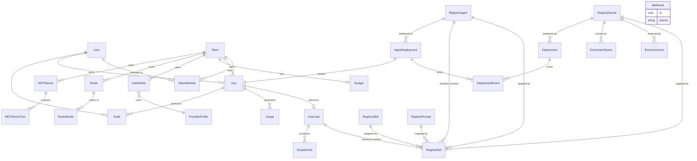

# Data Model

pllm uses PostgreSQL as the durable store and Redis for caches / queues. This
page enumerates every persisted entity and shows how they relate.

## Entity-relationship overview

## Account / org

| Entity | Purpose |
|---|---|
| **User** | Individual account — email, password hash, role |
| **Team** | Group of users with shared budget and ACLs |
| **TeamMember** | User ↔ Team with role (admin, member) |

## Auth / finance / audit

| Entity | Purpose |
|---|---|
| **Key** | API credential; see [API Keys & Permissions](/security/keys) |
| **Budget** | Team-scoped budget envelope |
| **Usage** | Per-request token / cost record (async-written) |
| **Audit** | Generic admin action log |

## LLM config

| Entity | Purpose |
|---|---|
| **UserModel** | A model binding owned by a team (e.g., "team-alpha's my-gpt-4") |
| **ProviderProfile** | Provider credentials + base URL (e.g., "OpenAI with team-alpha's key") |
| **Route** | Named routing config — e.g., fallback chain |
| **RouteModel** | Model priority within a route |

These parallel what you'd put in `config.yaml` but stored per-team in the DB
so teams can manage their own config through the UI.

## MCP runtime

| Entity | Purpose |
|---|---|
| **MCPServer** | Configured MCP backend (transport, URL / command, slug) |
| **MCPServerTool** | Cached tool manifest entry per backend |
| **MCPRoute** | (legacy) routing hints; being replaced by registry refs |

## Registry

| Entity | Purpose |
|---|---|
| **RegistryServer** | Versioned MCP server spec |
| **RegistryAgent** | Versioned agent spec (+ refs) |
| **RegistrySkill** | Reusable skill template |
| **RegistryPrompt** | Named prompt |
| **RegistryRef** | **Graph edge.** Owner-kind + target-kind typed edge |
| **EnrichmentJob** | Per-scan tracking record |
| **EnrichmentScore** | OSV scan result, score, advisories |

Four kinds of artifact + one edge table + enrichment = the whole registry.

## Deployments

| Entity | Purpose |
|---|---|
| **Deployment** | K8s workload for a `RegistryServer` |
| **AgentDeployment** | K8s workload for a `RegistryAgent` |
| **DeploymentEvent** | Operational audit (oom, status change, undeploy) |

## Governance (MRM)

| Entity | Purpose |
|---|---|
| **UseCase** | Top-level approval entity with declared refs |
| **ScopeEvent** | Denied / flagged decision audit |

## Webhooks

| Entity | Purpose |
|---|---|
| **Webhook** | Event subscription with HMAC secret |

## AutoMigrate gotcha

All of these entities are registered in **three** places for migration:

- `internal/core/database/connection.go`
- `internal/core/database/migrate.go`
- `internal/infrastructure/testutil/database.go`

**If you add a new model, update all three** or tests fail with
`relation does not exist`.

## Redis layout

| Key pattern | Purpose |
|---|---|
| `pllm:latency:{model_name}` | EMA latency per model (for least-latency routing) |
| `pllm:health:{instance_id}` | Circuit breaker state |
| `pllm:rate_limit:{key_id}:{window}` | Sliding-window rate limit counter |
| `pllm:budget:{key_id}` | Cached budget state (5 min TTL) |
| `pllm:usage_queue` | Usage queue (durable list) |
| `pllm:scope:{use_case_id}` | (in-proc cache, not Redis) Allowed sets for 30 s |

Redis is optional. In lite mode, rate limiting and cache fall back to
in-memory; budget tracking and usage analytics are disabled.

## Sizing

Rough estimates for a medium deployment (~1M req/day):

| Entity | Rows/day | Growth |
|---|---|---|
| `Usage` | ~1M | Most volume; partition by month if long retention |
| `ScopeEvent` | 100–10K (only denials) | Modest |
| `DeploymentEvent` | ~100 | Negligible |
| `Audit` | ~10K | Modest |
| Everything else | <1K | Effectively static |

Postgres handles this easily. Redis is pure cache / queue — size the queue
for peak burst, cache for 5-min TTL.
