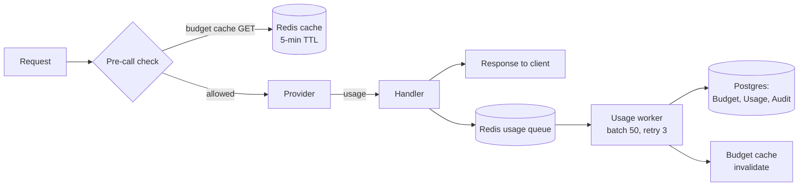

# Budgets & Usage

pllm tracks every token pllm sends through the gateway and settles it against
per-user, per-team, and per-key budgets — without blocking the request path.

## The async pipeline



Why async: per-request synchronous writes to Postgres would cap throughput at
the database's commit rate. By enqueueing and batching, we hit 10K+ req/s on
modest hardware without losing any records (the queue is durable).

## What's tracked

```go
type UsageRecord struct {
    RequestID    string
    Timestamp    time.Time
    UserID       string
    TeamID       string
    KeyID        string
    Model        string
    Provider     string
    InputTokens  int
    OutputTokens int
    TotalCost    float64
    Latency      int64
}
```

Cost is computed by the pricing manager
(`internal/core/config/pricing_manager.go`) using provider-specific rates, so
you can attribute spend to the actual upstream cost, not just token count.

## Setting budgets

### Per-key

```bash
curl -X POST http://localhost:8080/api/admin/keys \
  -H "Authorization: Bearer $MASTER" \
  -d '{
    "name": "team-alpha-prod",
    "team_id": "...",
    "max_budget": 500.00,
    "budget_duration": "monthly",
    "tpm": 100000,
    "rpm": 500,
    "max_parallel_calls": 10
  }'
```

### Per-team

```bash
curl -X POST http://localhost:8080/api/admin/teams \
  -H "Authorization: Bearer $MASTER" \
  -d '{
    "name": "team-alpha",
    "max_budget": 10000.00,
    "budget_duration": "monthly"
  }'
```

Individual keys inherit from their team unless they set their own limit.

## Monitoring

User self-service:

```bash
GET /v1/user/usage           # All-time
GET /v1/user/usage/daily     # Last 30 days, per day
GET /v1/user/usage/monthly   # Last 12 months
GET /v1/user/budget          # Current period status
```

Admin:

```bash
GET /api/admin/usage                    # All users
GET /api/admin/usage?user_id=...
GET /api/admin/usage?team_id=...
GET /api/admin/usage?key_id=...
```

Prometheus metrics (pulled by Grafana dashboards bundled in `deploy/grafana/`):

- `pllm_requests_total{model,provider,status}`
- `pllm_tokens_total{model,provider,direction}`
- `pllm_cost_usd_total{model,provider,team}`
- `pllm_request_duration_seconds{model,provider}`

## Budget duration

Supported windows: `hourly`, `daily`, `weekly`, `monthly`, `quarterly`, `yearly`.

Budgets reset at window boundaries; the reset is idempotent and runs on first
request in the new window (no scheduled job required).

## Exceeding a budget

When the cached budget check fails, the request returns `429 Too Many Requests`
with:

```json
{
  "error": {
    "message": "Budget exceeded for key team-alpha-prod (limit: $500.00, used: $502.31)",
    "type": "rate_limit_error",
    "code": "budget_exceeded"
  }
}
```

Because the check reads from cache, a key can briefly over-run the limit (by
at most one in-flight request worth of tokens). This is a deliberate trade-off
— the alternative is a synchronous Postgres read on every request.

## Disabling usage tracking

For lite mode (no Redis, no Postgres), usage tracking is skipped entirely and
budgets are always permitted. The gateway still logs to stdout if
`logging.level: info` is set.
