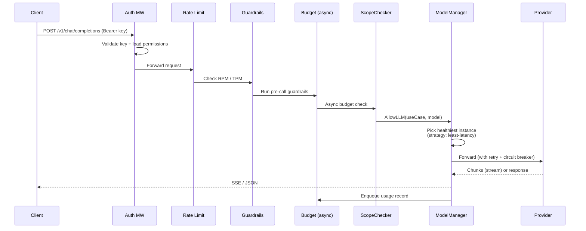

# LLM Gateway Overview

The LLM gateway is pllm's original surface: a single OpenAI-compatible endpoint
that routes to multiple providers with health tracking, failover, budgets, and
streaming.

## Endpoints

| Endpoint | Purpose |
|---|---|
| `POST /v1/chat/completions` | OpenAI chat API (streaming supported) |
| `POST /v1/messages` | Anthropic Messages format |
| `POST /v1/completions` | Legacy text completions |
| `POST /v1/embeddings` | Embeddings |
| `POST /v1/audio/transcriptions` | Whisper-style audio transcription |
| `POST /v1/audio/speech` | TTS |
| `POST /v1/images/generations` | Image generation |
| `GET /v1/realtime` | WebSocket realtime (OpenAI Realtime API) |
| `GET /v1/models` | List registered models |

Both `Bearer` and `X-API-Key` headers are accepted. A mirror of the same routes
lives under `/api/v1/*` for tools that assume API-key auth.

## Request lifecycle



Middleware ordering is deliberate — auth first (so everything downstream has a
key context), rate limit before guardrails (cheap check blocks expensive
checks), guardrails before budget (catch bad input without burning tokens).
Scope enforcement runs **inside the chat handler** once the model resolves.

## Configuring models

A model is a *name* + *provider params*. The name is what clients pass in
`"model"`; the provider params point at the real backend.

```yaml
model_list:
  - model_name: my-gpt-4
    params:
      model: gpt-4
      api_key: ${OPENAI_API_KEY}
    rpm: 500
    tpm: 100000
    priority: 1

  - model_name: my-gpt-4                 # same public name
    params:
      model: azure/my-deployment
      api_base: https://my-resource.openai.azure.com/
      api_key: ${AZURE_API_KEY}
      api_version: 2024-02-15-preview
    priority: 2                          # fallback

  - model_name: openrouter-claude
    params:
      model: anthropic/claude-3-sonnet
      api_key: ${OPENROUTER_API_KEY}
      api_base: https://openrouter.ai/api/v1
```

Two entries sharing the same `model_name` become **instances** of that model —
the gateway will pick one based on the configured strategy.

## Routing strategies

| Strategy | When to use |
|---|---|
| `priority` | Simple failover (try instance 1, fall back to 2, etc.) |
| `least-latency` | **Recommended for production** — picks the instance with lowest Redis-tracked latency |
| `weighted-round-robin` | Predictable traffic splits (e.g., 80% OpenAI, 20% Azure) |
| `random` | Even distribution without tracking cost |

Full details: [Routing & Load Balancing](/guide/routing).

## Resilience

Every provider instance has:

- a **circuit breaker** that opens on consecutive failures OR slow-request
  saturation (latency threshold + slow-request count)
- a **health tracker** with success rate and EMA latency
- **automatic fallback** to the next healthiest instance when the primary is
  unhealthy
- an **adaptive retry** with exponential backoff inside the provider adapter

See [Resilience](/guide/resilience) for circuit-breaker tuning, latency
thresholds, and failure-mode taxonomy.

## Budgets & usage

Usage is captured **asynchronously** — the request returns to the client as
soon as the provider finishes, and the token count is enqueued in Redis for a
background worker to settle.

- Budget cache (5-minute TTL) makes the pre-call check a single Redis GET
- Usage queue (batched, 50 records/batch, 3 retries) drains into Postgres
- User / Team / Key budgets are enforced independently

See [Budgets & Usage](/llm/budgets).

## Scope enforcement (when use cases are bound)

If a request's key has `UseCaseID` set, the chat handler calls
`ScopeChecker.AllowLLM(useCaseID, modelName)` before dispatching:

- unscoped key → bypass (backwards-compatible)
- master key → bypass
- use case with `EnforceScope=false` → allow; log `ScopeEvent{Outcome: flagged}`
- use case with `EnforceScope=true` + model not declared → **403** and
  `ScopeEvent{Outcome: denied}`

See [Scope Enforcement](/governance/scope) for the exact allow/deny
semantics.

## What's next

- [Providers](/providers) — supported providers and how to configure each
- [Routing](/guide/routing) — strategy comparison + tuning
- [Resilience](/guide/resilience) — circuit breakers and failover
- [Budgets](/llm/budgets) — usage accounting details
