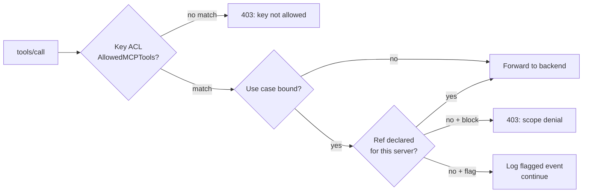

# Per-Tool ACL

Every API key carries a glob-based ACL for MCP tools. This lives on the key
itself — independent of use-case scoping — so you can grant broad capability
to a team key and narrow it on individual sub-keys.

## Fields

```go
type Key struct {
    AllowedMCPTools []string   // Whitelist — if set, only these match
    BlockedMCPTools []string   // Blacklist — always subtracted last
    // ...
}
```

Both are applied to the fully-qualified tool name **`<slug>__<tool>`**.

## Glob semantics

| Pattern | Matches |
|---|---|
| `*` | Everything |
| `github__*` | All tools from the `github` backend |
| `*__read` | A tool named `read` from any backend |
| `github__search_*` | Any `search_*` tool on `github` |
| `github__get_pull_request` | Exact match |

Evaluation order:

1. If `AllowedMCPTools` is non-empty, tool must match at least one pattern.
2. If `BlockedMCPTools` is non-empty, tool must match **none** of them.
3. Otherwise deny.

A key with both lists empty — and no use case bound — is treated as
**unrestricted** (master-key behavior). In production you want either a use
case or at least an allowlist.

## Examples

### Read-only GitHub key

```json
{
  "name": "reporting-bot",
  "allowed_mcp_tools": [
    "github__search_*",
    "github__get_*",
    "github__list_*"
  ],
  "blocked_mcp_tools": [
    "github__create_*",
    "github__update_*",
    "github__delete_*"
  ]
}
```

### Multi-backend agent

```json
{
  "name": "research-agent",
  "allowed_mcp_tools": [
    "fs__read_*",
    "fs__list_*",
    "web__fetch",
    "github__search_*"
  ]
}
```

### Locked-down subkey

```json
{
  "name": "untrusted-user",
  "allowed_mcp_tools": ["fs__read_*"],
  "blocked_mcp_tools": ["fs__read_secret*"]
}
```

## Interaction with use-case scope

When both are present, **the call must pass both checks**. This is a common
pattern: the key allows everything the team could ever need, and the use case
narrows it to what this activity specifically requires.



## Listing tools

A `tools/list` call returns the **intersection** of:

- all tools across all healthy backends
- the key's `AllowedMCPTools` / `BlockedMCPTools`
- the use case's declared servers (if bound)

This is important for clients like Claude Desktop — they show the user a menu
of what's possible, and you want that menu to match what will actually be
permitted at call time.

## Testing ACLs

```bash
# Master key bypass — see everything
curl -X POST http://localhost:8080/v1/mcp \
  -H "Authorization: Bearer $MASTER" \
  -d '{"jsonrpc":"2.0","method":"tools/list","id":1}'

# Restricted key — see only what's allowed
curl -X POST http://localhost:8080/v1/mcp \
  -H "Authorization: Bearer $RESTRICTED" \
  -d '{"jsonrpc":"2.0","method":"tools/list","id":1}'
```

If the two lists differ, your ACL is working.
