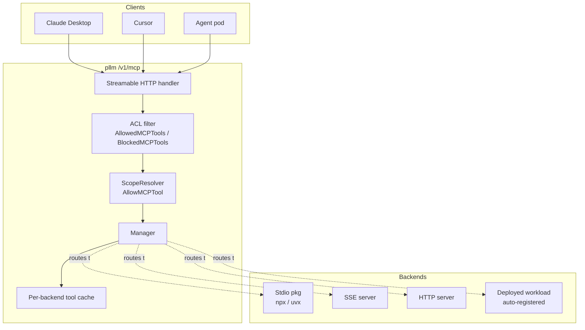
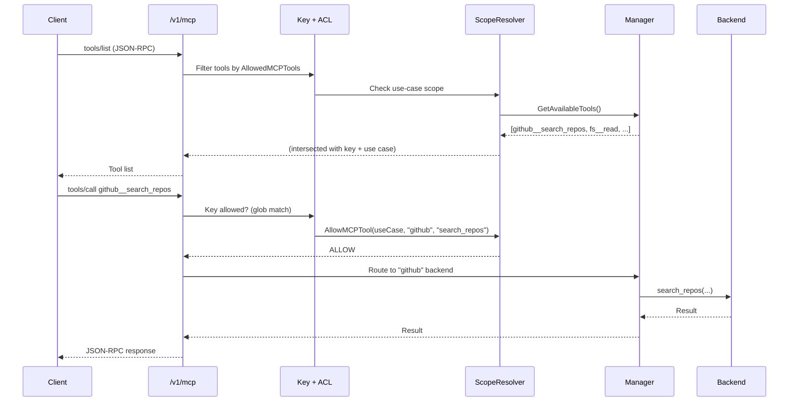

# MCP Gateway Overview

The Model Context Protocol (MCP) is an open spec for letting AI agents call
tools exposed by external servers. pllm's MCP gateway **aggregates any number
of MCP backends behind a single streamable HTTP endpoint** — `/v1/mcp`.

## What it does

1. **Runs backends**. Starts stdio packages (via a wrapper), connects to SSE
   endpoints, or forwards to native HTTP MCP servers.
2. **Aggregates tools** across all backends into one surface, namespaced as
   `<slug>__<tool>` to avoid collisions.
3. **Enforces ACLs**. Every key carries `AllowedMCPTools` / `BlockedMCPTools`
   glob patterns; requests are filtered before reaching the backend.
4. **Scopes to use cases**. When a key is bound to a use case, tool calls are
   additionally checked against `ScopeResolver.AllowMCPTool(useCase, server,
   tool)`.
5. **Auto-registers deployed workloads**. When pllm deploys a registry server
   to Kubernetes, the `MCPBridge` auto-registers the workload as a backend —
   its tools appear under `reg-<workload>__*` without manual wiring.

## Endpoints

| Endpoint | Use |
|---|---|
| `POST /v1/mcp` | Streamable HTTP gateway. Clients (Claude Desktop, Cursor, agent SDKs) send JSON-RPC; the gateway fans out. |
| `POST /v1/mcp/registry` | **Registry exposed as an MCP server.** Lets agents discover registry artifacts via MCP tool calls (`list_servers`, `get_agent`, etc.). See [Registry as MCP](/mcp/registry-as-mcp). |
| `GET /api/admin/mcp/servers` | List configured backends. |
| `POST /api/admin/mcp/servers` | Register a new backend (or it's done automatically on deploy). |
| `POST /api/admin/mcp/tools/invoke` | Invoke a tool by name for testing. |

## Architecture



## Data model

Two tables back the gateway:

| Table | What it holds |
|---|---|
| `MCPServer` | Configured backend: transport type, command/URL, env, slug, session state |
| `MCPServerTool` | Cached tool manifest per backend (name, description, input schema) |

These are **distinct from the registry catalog** (`RegistryServer` /
`RegistryAgent` / etc.). A backend is something that is currently running and
callable; a registry artifact is a versioned spec. The two are connected by
deployment — deploying a `RegistryServer` creates a matching `MCPServer` entry.

## A typical MCP request



## Configuration

```yaml
mcp:
  enabled: true                   # Toggle the feature
  health_check_interval: 30s      # Backend health probe cadence
  start_timeout: 30s              # Max time to boot a new backend
```

Most MCP state is **data-driven** — backends are stored in the database and
managed via the admin API or UI. The config only toggles the feature and sets
a few timing defaults.

## What's next

- [Backends & Transports](/mcp/backends) — stdio vs SSE vs HTTP, the wrapper image
- [Per-Tool ACL](/mcp/acl) — glob patterns on keys
- [Registry as MCP](/mcp/registry-as-mcp) — agents discovering registry via MCP
