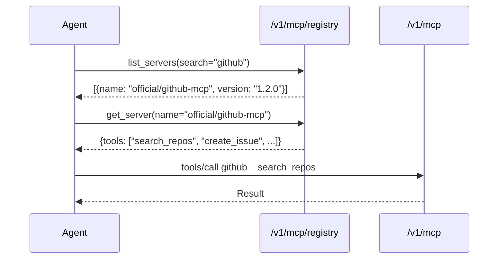

# Registry as MCP

pllm's registry can be used as an MCP server itself. This lets agents **discover
the catalog through MCP tool calls** — the same way they'd use any other
backend — rather than hitting a separate REST API.

## The endpoint

```
POST /v1/mcp/registry
```

Same streamable-HTTP contract as `/v1/mcp`, but the only backend is pllm's
own registry.

## Tools exposed

| Tool | Arguments | Returns |
|---|---|---|
| `list_servers` | `search?`, `limit?`, `offset?` | Array of server summaries |
| `get_server` | `name`, `version?` | Full artifact |
| `list_agents` | `search?`, `limit?`, `offset?` | Array of agent summaries |
| `get_agent` | `name`, `version?` | Full artifact with `refs[]` |
| `list_skills` | `search?`, `limit?`, `offset?` | Array |
| `get_skill` | `name`, `version?` | Full artifact |
| `list_prompts` | `search?`, `limit?`, `offset?` | Array |
| `get_prompt` | `name`, `version?` | Full artifact |
| `list_refs` | `target_kind`, `target_name` | Owners that reference this target |

All names support the registry's fully-qualified `<namespace>/<name>` format or
a short-name fallback.

## Why expose the registry as MCP?

**Agents need to discover capabilities at runtime.** If an agent is asked
"what tools can you use?", we want it to read the answer from the same
catalog the platform team curates — not hardcode a list in its code.

The flow that replaces the hardcoded list:



Both `MCPR` and `MCPG` check scope against the agent's key — an agent that
isn't declared against a server won't see it in `list_servers` and will get a
denial if it hard-codes the name.

## Scoping

The registry-as-MCP endpoint applies the same visibility filters as the REST
registry:

- Public artifacts (visibility=`public`) — visible to any authed user
- Private artifacts — visible only to members of the owning team
- Scope-limited — if the caller's key has a use case, only artifacts that
  appear in the use case's ref graph are returned

The scoping is applied to **both `list_*` and `get_*`** — an agent can't
enumerate via list, then request the artifact by name.

## Comparison with REST

| | REST `/v1/registry/*` | MCP `/v1/mcp/registry` |
|---|---|---|
| Protocol | HTTP + JSON | JSON-RPC over HTTP stream |
| Client | Humans, admin UI, CLI | Agents, Claude Desktop |
| Auth | Same (Bearer / X-API-Key) | Same |
| Scope filter | Yes | Yes |
| Good for | Scripted workflows, UI | In-context agent discovery |

Most human-facing tools use REST. Most agent-facing tools use MCP. Both exist
because both audiences are first-class.
