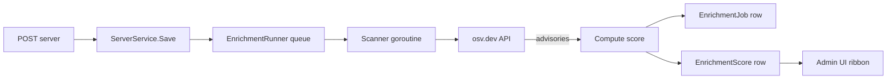

# OSV Enrichment & Scores

Every `RegistryServer` gets scanned against the Open Source Vulnerabilities
(OSV) database when it's published. The score tells you at a glance whether a
server has known security issues — and at what severity.

## The pipeline



Runs in-process, asynchronously — publish calls return immediately; the score
shows up in the admin UI within seconds.

## The score

```go
type EnrichmentScore struct {
    ServerID   UUID
    Version    string     // which version was scanned
    Score      int        // 0–100, higher = safer
    HighCount  int
    MediumCount int
    LowCount   int
    Advisories []AdvisoryRef  // OSV IDs + URLs
    ScannedAt  time.Time
}
```

The 0–100 score is a composite:

- **100** — no vulnerabilities found
- **80–99** — low-severity advisories only
- **40–79** — medium-severity advisories, or several lows
- **0–39** — at least one high / critical advisory

The UI ribbon colors reflect severity rather than raw score:

| Score | Color | UI label |
|---|---|---|
| 80+ | green | `safe` |
| 40–79 | amber | `advisories` |
| < 40 | rose | `critical` |

## Where it shows up

**Registry page:**
- Score ribbon on each server card, top-right
- Filterable by score range
- Click card → detail drawer → **Security** tab for the raw advisory list

**Admin API:**

```bash
curl http://localhost:8080/v1/registry/servers/official/github-mcp \
  -H "Authorization: Bearer $KEY"

# Response includes:
{
  ...,
  "enrichment_score": 82,
  "enrichment_scanned_at": "2026-04-01T10:00:00Z",
  "advisories": [
    { "id": "GHSA-...", "severity": "low", "url": "..." }
  ]
}
```

## Re-scanning

Scanning runs automatically on:

1. **Publish / update** of a `RegistryServer`
2. **Manual trigger** via `POST /api/admin/registry/enrichment/rescan` (admin only)
3. **Scheduled rescan** — the runner re-queues all servers on a cadence (every
   24h by default) so advisories that land after publish time are picked up.

## Scanner scope

Currently OSV only. Roadmap:

- **GitHub Scorecard** — code-level quality signals (branch protection, CI,
  token handling)
- **Trivy container scan** — for servers packaged as OCI images
- **License policy** — flag servers under disallowed licenses

See [Known Gaps](/#known-gaps-next-steps).

## What the score doesn't do

The score is a **hint**, not a gate. It doesn't block publishing or deploying.
The intended workflow is:

1. Agent developer declares a ref on a server
2. Use-case approver sees the red ribbon and refuses to approve
3. Developer picks a different server (or pins a patched version)

If you want hard gates — "block publish if score < 60" — add a policy layer.
pllm doesn't provide one out of the box yet.
