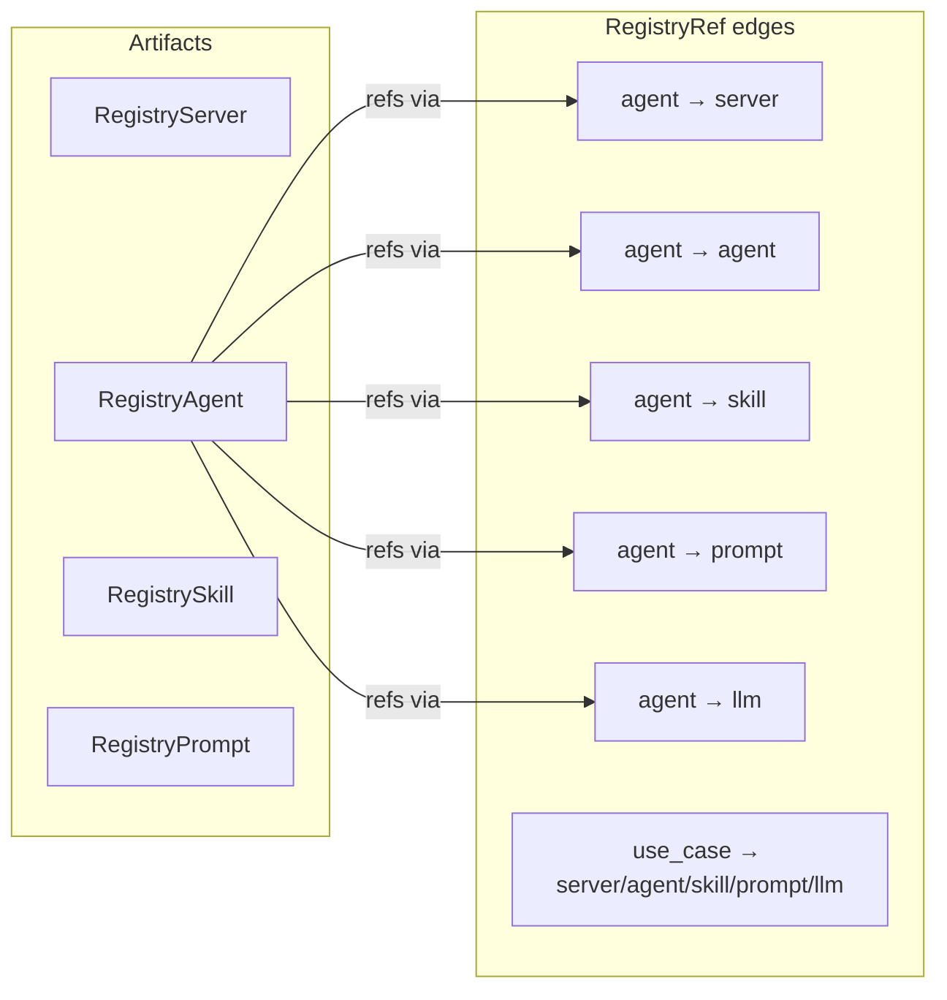

# Registry Overview

The registry is a **curated internal catalog** of four artifact kinds, linked
by a typed graph. It's the source of truth for what your organization allows
agents and tools to do.

## Four artifact kinds

| Kind | What it is | Example |
|---|---|---|
| **Server** | An MCP server package (stdio/SSE/HTTP) | `@modelcontextprotocol/server-github v2024.11.5` |
| **Agent** | A published autonomous agent with declared dependencies | `pllm.io/agent-research v0.1.0` |
| **Skill** | A reusable prompt template + parameter schema | `pllm.io/skill-summarize v1.0` |
| **Prompt** | A named prompt with versioning | `pllm.io/prompt-triage v0.3` |

All four share the same shape: name, version, is_latest flag, metadata,
optional package reference, and edges.



## Endpoints

**Public (reads, any authed user):**

```
GET  /v1/registry/servers
GET  /v1/registry/servers/{name}
GET  /v1/registry/servers/{name}/versions
GET  /v1/registry/servers/{name}/versions/{version}

GET  /v1/registry/agents/*        # same shape
GET  /v1/registry/skills/*
GET  /v1/registry/prompts/*

GET  /v1/registry/refs?target_kind=server&target_name=...
```

**Admin (writes):**

```
POST   /api/admin/registry/servers
DELETE /api/admin/registry/servers/{name}/versions/{version}

POST   /api/admin/registry/agents          # same shape
POST   /api/admin/registry/skills
POST   /api/admin/registry/prompts

POST   /api/admin/registry/import          # npm / PyPI bulk import
```

## Versioning

Each artifact has a composite unique key on `(name, version)`. Publishing a
new version flips the `is_latest` flag on the new row and clears it on the
old one — readers who don't specify a version always get the latest.

```json
{
  "name": "pllm.io/agent-echo",
  "version": "0.2.0",
  "is_latest": true,
  "metadata": { "description": "Echo back the input", ... },
  "package": {
    "type": "oci",
    "identifier": "registry.example.com/pllm/agent-echo:0.2.0"
  },
  "refs": [
    { "kind": "llm", "target_kind": "llm", "target_name": "my-gpt-4" }
  ]
}
```

Older versions remain available and queryable — `GET /versions` returns the
history. Deploys can pin a specific version; operators upgrade by changing the
deployment's `version` field.

## Where artifacts come from

1. **Hand-published** via `POST /api/admin/registry/*`. Platform team reviews,
   commits the spec, version bumps.
2. **Imported** from npm or PyPI via the importer. Bulk ingests thousands of
   packages into the `<type>.import/<identifier>` namespace with a separate
   visibility flag so they don't clutter curated artifacts.
3. **Discovered** at deployment time — when you deploy something, a registry
   row is ensured to exist.

See [npm / PyPI Importers](/registry/importers).

## Enrichment

Once a `RegistryServer` is published, the `EnrichmentRunner` schedules an
async OSV scan against the package's identifier. The result:

- **`EnrichmentJob`** — one per scan, tracks run status
- **`EnrichmentScore`** — score (0–100), severity counts, advisory IDs

Admin UI surfaces the score as a colored ribbon on each server card. A green
ribbon means no known vulnerabilities; amber means low-severity advisories;
rose means high/critical.

See [OSV Enrichment & Scores](/registry/enrichment).

## Refs — the graph

`RegistryRef` is a **typed edge** linking an owner to a target:

```go
type RegistryRef struct {
    OwnerKind   string  // "agent" or "use_case"
    OwnerName   string  // e.g. "pllm.io/agent-research"
    OwnerVersion string // pinned, or empty = latest

    TargetKind  string  // "server", "agent", "skill", "prompt", "llm"
    TargetName  string  // e.g. "my-gpt-4"
    TargetVersion string // pinned, or empty = latest

    LocalName   string  // alias used inside the owner's code
    Required    bool
    Metadata    JSON
}
```

One table, one shape, two owner kinds. Agents use edges to declare their
dependencies; use cases use edges to declare their approved component set.
This is the keystone of the scope model.

See [References & the Graph](/registry/refs).

## Cross-refs

A common question: *"I want to deprecate this server — who depends on it?"*

```bash
curl "http://localhost:8080/v1/registry/refs?target_kind=server&target_name=deprecated-server"
```

Returns **both** agent owners and use-case owners that declare an edge to the
target. Feed this into your deprecation workflow.

## What's next

- [Artifacts & Versioning](/registry/artifacts) — schema details and patterns
- [References & the Graph](/registry/refs) — owner/target kinds, traversal
- [OSV Enrichment](/registry/enrichment) — how scoring works
- [Importers](/registry/importers) — npm and PyPI bulk import
