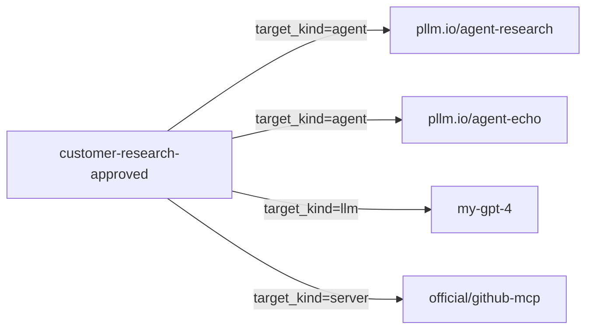
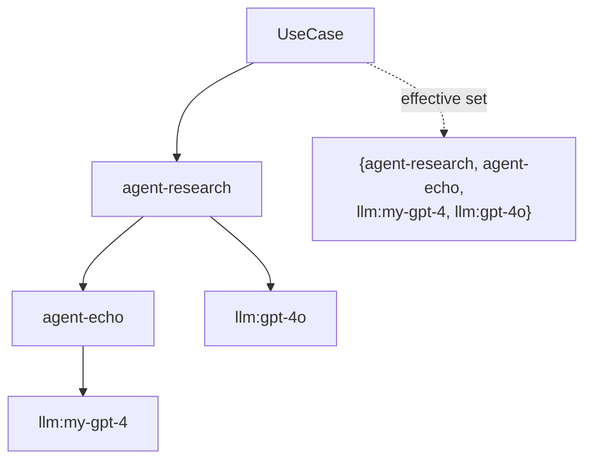

# References & the Graph

`RegistryRef` is a single table that stores every edge in the registry graph.
Two kinds of owners (`agent`, `use_case`) point at five kinds of targets
(`server`, `agent`, `skill`, `prompt`, `llm`).

Understanding how these edges compose is how you understand scope enforcement.

## The row

```go
type RegistryRef struct {
    ID            UUID
    OwnerKind     string    // "agent" or "use_case"
    OwnerName     string
    OwnerVersion  string    // pinned, or "" = latest

    TargetKind    string    // "server" | "agent" | "skill" | "prompt" | "llm"
    TargetName    string
    TargetVersion string    // pinned, or "" = latest

    LocalName     string    // alias used inside the owner (agent code, usually)
    Required      bool      // if true, owner fails validation without it
    Metadata      JSON      // free-form
}
```

**Owner kinds:**
- `agent` — the ref declares a dependency (composition)
- `use_case` — the ref declares an approved resource (authorization)

Both kinds live in the same table because the graph traversal algorithm is
identical: walk the refs outward, collect targets, check against a predicate.

## The two graphs

### Composition (agent → targets)

An agent declares what it's made of:

```mermaid
graph LR
    Research[pllm.io/agent-research v0.1.0]
    Research -->|target_kind=server<br/>local_name=search| Brave[brave-search-mcp]
    Research -->|target_kind=server<br/>local_name=fs| FS[@modelcontextprotocol/server-filesystem]
    Research -->|target_kind=skill<br/>local_name=summarize| Skill[pllm.io/skill-summarize]
    Research -->|target_kind=llm<br/>local_name=default_model| Model[my-gpt-4]
```

At runtime, the agent's code references `local_name`s like `search` and
`default_model` — pllm translates those to the real targets through the
ref graph.

### Authorization (use_case → allowed targets)

A use case declares what it's allowed to touch:



Anything not in this set — even if the agent declares it — gets blocked (or
flagged) at runtime when called by a key bound to this use case.

## Transitive resolution

When checking scope, the Reconciler walks the full transitive closure of an
agent's refs. If `agent-research` refs `agent-echo` and `agent-echo` refs
`llm:my-gpt-4`, then the use case that approves `agent-research` needs to see
`my-gpt-4` at the leaves.



This is why `UseCase.EffectiveClassifications` is materialized: the Reconciler
writes it once on create/update, and runtime checks are a hash lookup instead
of a recursive query.

## The RefService API

```bash
# Who references this target?
GET /v1/registry/refs?target_kind=server&target_name=github-mcp

# Returns:
{
  "refs": [
    {
      "owner_kind": "agent",
      "owner_name": "pllm.io/agent-research",
      "local_name": "github",
      ...
    },
    {
      "owner_kind": "use_case",
      "owner_name": "customer-research-approved",
      ...
    }
  ]
}
```

This is the **deprecation query**. Before you delete a server version, run
this to see exactly who breaks.

## Pinning vs floating

`target_version = ""` means "latest". This is convenient for development but
dangerous for regulated deployments — a new version of a dependency could
change behavior silently. Best practice:

- **Agents** usually pin their refs to a specific version. You'd re-publish
  the agent to upgrade.
- **Use cases** pin the agents and LLMs they approve. A use case approval is
  tied to a specific dependency graph; if it changes, it needs re-approval.

## Circular refs

The Reconciler BFS has a depth cap of 6. Beyond that, it bails out and marks
the use case as having a `ComplianceFlag`. In practice, legitimate graphs are
flat — if you're hitting depth 6 you're probably doing something wrong.

Self-refs (agent pointing at itself) are rejected at write time.

## Local names

`LocalName` is the alias the *owner* uses to refer to the target. An agent
might declare:

```json
{ "target_name": "my-gpt-4", "local_name": "default_model" }
```

…so that its own code reads `default_model` and the platform picks the actual
model at runtime. If someone later wants to swap the model without touching the
agent code, they update the ref's `target_name`.
