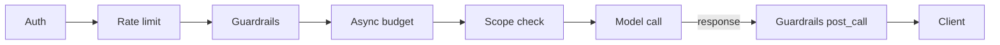

# Guardrails

Guardrails are content-inspection middleware: they look at the prompt (or the
completion) and block / sanitize / log based on what they find. pllm ships
integrations with four upstream providers and pluggable modes.

## Providers

| Provider | Typical use |
|---|---|
| **Presidio** | PII detection + anonymization (Microsoft open-source) |
| **Lakera** | Prompt-injection detection and jailbreak filtering |
| **OpenAI moderation** | Hate, violence, sexual content classification |
| **Aporia** | Broad LLM safety (hallucinations, policy violations) |

Each provider is a plug-in under `internal/services/integrations/guardrails/`.
You can enable as many as you want; they run in sequence.

## Modes

Each guardrail has a `mode`:

| Mode | What it does |
|---|---|
| `pre_call` | Inspect the request **before** it hits the LLM; block on violation |
| `post_call` | Inspect the response; block or sanitize before returning to client |
| `during_call` | Wrap streaming responses; emit violations mid-stream |
| `logging_only` | Inspect and log, but never block |

A common production pattern: Presidio in `pre_call` (strip PII before it
leaves your network), Lakera in `pre_call` (block prompt injection), OpenAI
moderation in `post_call` (catch unsafe completions).

## Configuration

```yaml
guardrails:
  enabled: true

  guardrails:
    - guardrail_name: pii-scrubber
      provider: presidio
      mode: pre_call
      enabled: true
      default_on: true
      timeout: 5s

    - guardrail_name: jailbreak-detector
      provider: lakera
      mode: pre_call
      enabled: true
      default_on: true
      timeout: 3s

    - guardrail_name: safety-moderator
      provider: openai
      mode: post_call
      enabled: true
      default_on: true

  providers:
    presidio:
      analyzer_url: http://presidio-analyzer:5001
      anonymizer_url: http://presidio-anonymizer:5002
      language: en

    lakera:
      api_key: ${LAKERA_API_KEY}
      base_url: https://api.lakera.ai/v1
      timeout: 3s

    openai:
      api_key: ${OPENAI_API_KEY}
      base_url: https://api.openai.com/v1

    aporia:
      api_key: ${APORIA_API_KEY}
      base_url: https://api.aporia.com
```

## Middleware position



Guardrails run **after auth and rate limiting** (so cheap checks gate
expensive ones) and **before budget accounting** (so blocked requests don't
consume budget).

## Per-key overrides

Default-on guardrails apply to every call. A key can opt out of specific
guardrails:

```json
{
  "name": "research-key",
  "disabled_guardrails": ["jailbreak-detector"]
}
```

Useful for trusted internal keys that would otherwise be false-positive-noisy.

## Triggering a guardrail block

When a `pre_call` or `post_call` guardrail violates, the client sees:

```json
{
  "error": {
    "message": "Request blocked by guardrail 'pii-scrubber': detected PII (EMAIL_ADDRESS)",
    "type": "guardrail_error",
    "code": "blocked_by_guardrail",
    "data": {
      "guardrail": "pii-scrubber",
      "violations": [{"type": "EMAIL_ADDRESS", "location": "messages[0].content"}]
    }
  }
}
```

HTTP 400 (pre_call) or 502 (post_call) depending on origin.

## Testing guardrails

```bash
curl -X POST http://localhost:8080/api/admin/guardrails/test \
  -H "Authorization: Bearer $MASTER" \
  -d '{
    "guardrail_name": "pii-scrubber",
    "content": "My email is alice@example.com and my SSN is 123-45-6789"
  }'
```

Returns the guardrail's decision (allow / block / transform) and detected
violations — without hitting an LLM.

## Admin endpoints

```
GET  /api/admin/guardrails                              List + status
GET  /api/admin/guardrails/{guardrailName}              Detail
GET  /api/admin/guardrails/{guardrailName}/stats        Hit/miss counters
GET  /api/admin/guardrails/{guardrailName}/health       Provider liveness
POST /api/admin/guardrails/test                         Dry-run one message
```

The admin UI renders these under **Settings → Guardrails**.

## Caveats

- **MCP tool responses are not inspected yet.** Guardrails run on LLM calls.
  If you want to inspect a GitHub MCP tool's response for PII, you need
  another layer — the roadmap lists this as future work.
- **Streaming + guardrails** — `post_call` works on final response; true
  `during_call` for stream inspection requires the provider to support token-
  level scanning (Aporia does; others vary).
- **Guardrail latency counts toward LLM latency.** Keep the timeouts tight
  (2–5 s) or users will notice.
